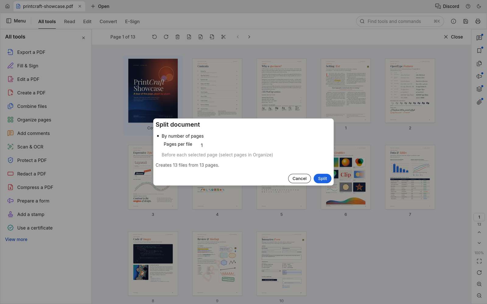

<p align="center">
  
</p>

<h1 align="center">Folio</h1>

<p align="center">
  <b>A quieter place to read, study, and craft PDFs.</b><br>
  Distraction-free, local, and monochrome — redesigned for avid readers and built on the open-source PdfCraft engine.
</p>

<p align="center">
  
  
  
  
  
</p>

<p align="center">
  <a href="#why-folio"><b>Why Folio</b></a> ·
  <a href="#flagship-features"><b>Flagship Features</b></a> ·
  <a href="#folio-vs-adobe-vs-pdfcraft"><b>Comparison</b></a> ·
  <a href="#download--installation"><b>Download</b></a> ·
  <a href="#macos-gatekeeper-note"><b>macOS Gatekeeper Note</b></a> ·
  <a href="#credits--heritage"><b>Credits & Heritage</b></a>
</p>

<br>

<p align="center">
  
  <br>
  <sub><i>The Folio Home Dashboard: distraction-free, customizable pinned tools, folder shortcuts, and zero account clutter.</i></sub>
</p>

---

## Why Folio?

Most PDF applications today—from Adobe Acrobat to corporate enterprise viewers—feel like they were designed in 2004 for office administrators, not readers. 

They are weighed down by:
- **Cluttered Toolbars & Navigation Rails**: Thick panels, side drawers, and floating menus that eat up your screen, shrinking the actual PDF document into a tiny central box.
- **Aggressive Cloud Upsells & Account Gates**: Constant prompts to sign in, upload your private documents to third-party clouds, or subscribe to monthly plans.
- **Eye-Fatiguing Interfaces**: Stark white or noisy grey chrome that hurts your eyes during multi-hour study and reading sessions.

**Folio was built on a simple, uncompromising principle: The document is sacred.**

Your reading area should be maximized at all times. Tools should complement your reading and editing workflow without demanding attention or encroaching on your screen. When you want to read, the interface gets out of the way. When you need to annotate, split, edit, or sign, the tools are right under your fingertips.

---

## Flagship Features

### 📖 Maximum Viewport & 2-Row Chrome
No permanent side navigation rails eating away your horizontal screen width. Folio organizes your space into two compact, elegant rows:
- **Top Bar**: Clean tab management, quick file open, focus toggle, palette switcher, and global settings.
- **Contextual Tool Row**: Unobtrusive annotation and editing tools placed right above the document.

### 🧘 One-Click Focus Mode
Immerse yourself completely in long-form textbooks, research papers, or legal briefs. Toggle **Focus Mode** with a single click (or shortcut) to make all toolbars vanish. Your document fills the entire screen. The toolbar re-emerges smoothly only when you move your cursor to the top edge.

<br>

<p align="center">
  
  <br>
  <sub><i>True Split View: Inspired by modern browser reading modes, view two documents or two sections side-by-side with independent zoom and toolbars.</i></sub>
</p>

### 🪟 True Split View (Edge-Inspired Dual Reading)
Compare documents, cross-reference source material, or annotate lecture notes side-by-side without opening multiple windows or cluttering your taskbar.
- Each pane retains **independent zoom, page navigation, and active toolsets**.
- **Horizontal Position Lock**: Keeps your reading alignment consistent across mixed-width pages and dual-pane views.

### 🎨 Curated Eye-Comfort Themes
Read for hours in any ambient lighting condition without visual fatigue:
- **Monochrome Dark & Light**: A peaceful black, grey, and white palette that lets the PDF colors speak for themselves.
- **Nordic**: Cool, calming slate tones designed for deep concentration.
- **Dracula**: High-contrast, vibrant dark theme loved by developers.
- Cycle instantly with the top-bar palette button.

### ⚡ Tool-First Launch & Customizable Home
If you don't just want to read, Folio gets you straight to work:
- **Direct Action Workflows**: Click **"Edit a PDF"**, **"Organize pages"**, or **"Fill & Sign"** directly on Home. Choose your document, and Folio automatically loads straight into that tool's active workspace.
- **Drag-and-Drop Reordering**: Rearrange your pinned tools in the order you use them.
- **Pinned Folder Hub**: Pin frequently accessed project directories (like `Research Papers` or `Invoices`) directly to your home screen for one-click access.

### 🛠️ Serious PDF Power Under the Hood
Folio retains 100% of the battle-tested, high-performance open-source **PdfCraft** Rust engine:
- **Form XObject & Text Editing**: Inline text editing, complex word wrap (including Thai script segmentation), and typography precision.
- **Scan & OCR In-Place**: Built-in text recognition models (offline ONNX neural models) to make scanned pages searchable and clean up camera captures.
- **Deep Redaction**: Pattern-based redaction with custom user regex, metadata sanitization, and permanent byte removal.
- **Print Production & Presets**: Custom $N$-up grid printing up to $99 \times 99$, Folio and F4 paper presets, and automatic per-printer settings memory.
- **Forms & Signatures**: Add typed, drawn, or scanned image signatures, fill interactive AcroForms, or prepare new fields.

---

## Folio vs. Adobe vs. Upstream PdfCraft

| Capability / Experience | Adobe Acrobat | Upstream PdfCraft | **Folio** |
| :--- | :---: | :---: | :---: |
| **Interface Philosophy** | Cluttered enterprise workspace | Functional PDF utility | **Distraction-Free Reading Sanctuary** |
| **Reading Viewport** | Reduced by toolbars & rails | Standard | **Maximized (Zero wasted side space)** |
| **Focus Mode** | Clunky modal fullscreen | Basic fullscreen | **Seamless 1-Click Hide/Reveal Chrome** |
| **Dual Split View** | Clunky window duplicates | Basic split | **Integrated Independent Dual View** |
| **Color Themes** | Corporate grey / white | Dark / Light | **Monochrome, Nordic, Dracula, Dark, Light** |
| **Home Dashboard** | Ads, cloud upsells & recents | Basic list | **Customizable Pinned Tools & Folder Hub** |
| **Tool-First Launch** | Multi-step navigation | Standard open | **1-Click Launch into Requested Workspace** |
| **Telemetry & Accounts** | Mandatory login & tracking | No account | **100% Private, Offline & No Telemetry** |
| **Engine Tech** | Proprietary legacy C++ | Modern Rust Engine | **Modern Rust Engine (`hayro`, `cos`, `egui`)** |

---

## Download & Installation

Folio releases are built natively for all major desktop platforms:

### 🍏 macOS (Apple Silicon: M1 / M2 / M3 / M4)
Download the latest disk image from [**Releases**](https://github.com/TINZUR/pdfcraft/releases):
1. Download `folio-20.0.1-macos-aarch64.dmg`.
2. Double-click the `.dmg` and drag **Folio.app** into your `/Applications` folder.

> [!TIP]
> ### 🍎 macOS Gatekeeper Note (A Quick Word on Developer Fees)
> When you first open Folio on macOS, Gatekeeper might show a popup saying *"Folio is damaged and can't be opened"* or *"Apple cannot verify the developer"*.
> 
> **Why this happens:** Apple requires developers to pay an annual **\$99/year fee** to obtain an official notarization ticket. As an independent open-source developer building this project for fun and the love of reading, paying Apple \$99 every year just to distribute a free hobby app is a bit much!
> 
> **How to open Folio in 5 seconds:**
> - **Option 1 (Simple):** Right-click (or Control-click) `Folio.app` in `/Applications` → click **Open** → click **Open Anyway**.
> - **Option 2 (Terminal):** Run this one-liner in your Terminal:
>   ```bash
>   xattr -cr /Applications/Folio.app
>   ```
> That's it! Gatekeeper will never bother you again for Folio.

---

### 🪟 Windows
1. Download `folio-20.0.1-windows-x86_64.zip` (Intel/AMD) or `folio-20.0.1-windows-arm64.zip` from [**Releases**](https://github.com/TINZUR/pdfcraft/releases).
2. Extract the archive and run `folio.exe`.

### 🐧 Linux
1. Download the `.deb` package (Debian/Ubuntu/Mint) or `.tar.gz` portable binary from [**Releases**](https://github.com/TINZUR/pdfcraft/releases).
2. Install via:
   ```bash
   sudo dpkg -i folio-20.0.1-amd64.deb
   ```

---

## Building from Source

If you prefer building Folio from source, all you need is a standard Rust toolchain (1.85+):

```bash
# Clone the repository
git clone https://github.com/TINZUR/pdfcraft.git
cd pdfcraft

# Run in debug mode
cargo run --bin pdfcraft -- path/to/document.pdf

# Or build the optimized release binary
cargo build --release --bin pdfcraft
```

---

## Credits & Heritage

Folio is an independent, distraction-free reading shell created by **TINZUR**, built upon the remarkable open-source engineering of **[PdfCraft](https://github.com/storytold/pdfcraft)**:

- **Original Project & Core Engine**: [storytold/pdfcraft](https://github.com/storytold/pdfcraft) (Licensed under `MIT OR Apache-2.0`).
- **Rendering & Parser Foundation**: `hayro`, `cos`, and the `lopdf` ecosystem.
- **GUI Framework**: Built on the immediate-mode [egui](https://github.com/emilk/egui) toolkit.
- **Icons**: [Lucide](https://lucide.dev/) open-source icon set.
- **Typography**: Inter, JetBrains Mono, and Dancing Script (OFL-1.1).

*Folio contains zero proprietary Adobe assets, zero telemetry trackers, and zero cloud lock-ins. Crafted for people who simply want a quieter place to read.*
