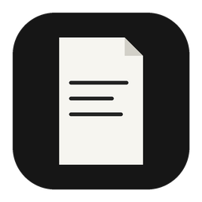
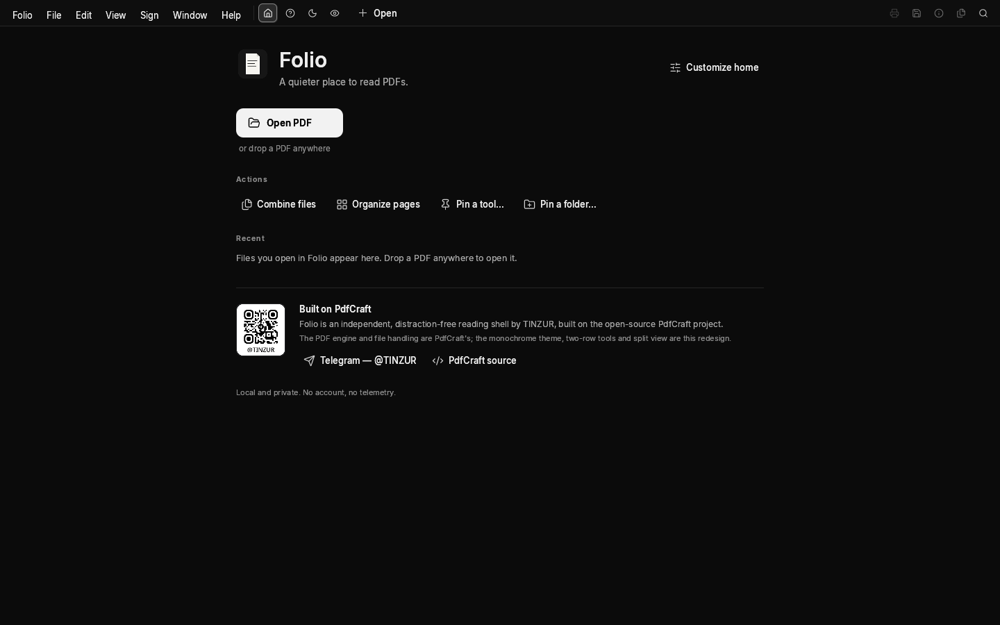
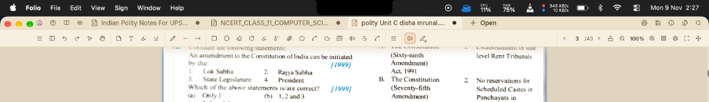
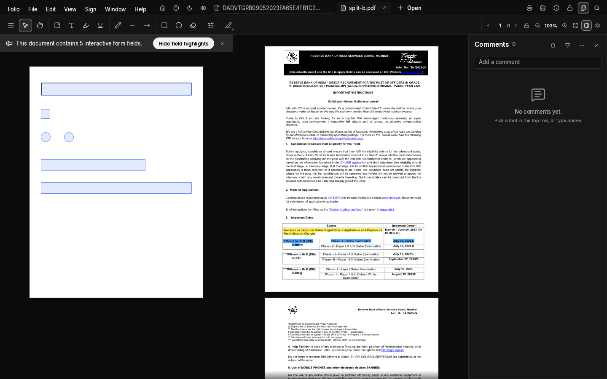
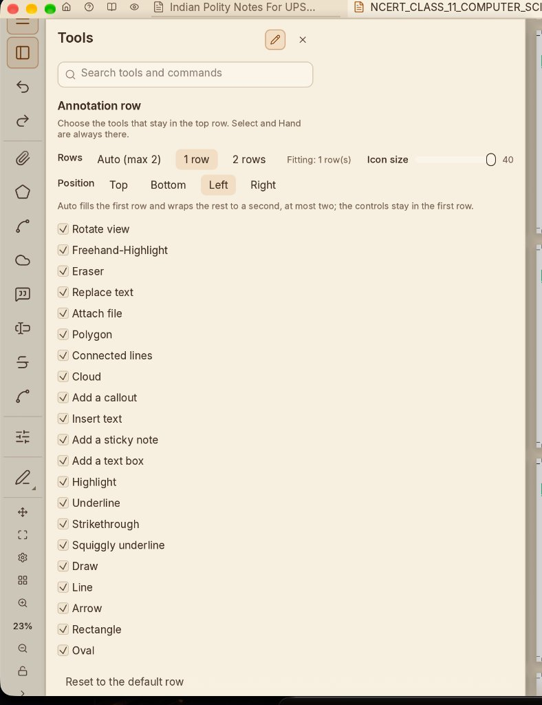

<p align="center">
  
</p>

<h1 align="center">Folio</h1>

<p align="center">
  <b>A quieter place to read, study, and craft PDFs.</b><br>
  Distraction-free, local, and monochrome — redesigned for avid readers and built on the open-source PdfCraft engine.
</p>

<p align="center">
  
  
  
  
  <a href="https://t.me/Tinzur"></a>
  
</p>

<p align="center">
  <a href="#why-folio"><b>Why Folio</b></a> ·
  <a href="#flagship-features"><b>Flagship Features</b></a> ·
  <a href="#folio-vs-adobe-vs-upstream-pdfcraft"><b>Comparison</b></a> ·
  <a href="#download--installation"><b>Download</b></a> ·
  <a href="#macos-gatekeeper-note"><b>macOS Gatekeeper Note</b></a> ·
  <a href="#credits--heritage"><b>Credits & Heritage</b></a>
</p>

<br>

<p align="center">
  
  <br>
  <sub><i>The Folio Home Dashboard: distraction-free sanctuary, customizable pre-pinned workflow tools, folder shortcuts, and zero account clutter.</i></sub>
</p>

---

## Why Folio?

Most PDF applications today—from Adobe Acrobat to corporate enterprise viewers—feel like they were designed in 2004 for office administrators, not readers.

They are weighed down by:
- **Cluttered Toolbars & Permanent Navigation Rails**: Thick side panels and floating buttons that eat up 25–30% of your screen width, squeezing your reading material into a tiny central box.
- **Aggressive Cloud Upsells & Account Gates**: Incessant prompts to log in, sync documents to third-party servers, or subscribe to monthly enterprise tiers.
- **Eye-Fatiguing Interfaces**: Stark white or noisy grey chrome that strains your eyes during long study and reading sessions.
- **Buried PDF Actions**: If you just want to edit text, organize pages, or sign a document, you shouldn't have to open a PDF viewer first and dig through nested menus.

**Folio was built on a simple, uncompromising principle: The document is sacred.**

Your reading canvas should be maximized at all times. Tools should complement your reading and editing workflow without demanding attention or stealing screen real estate. When you want to read, the interface gets out of your way. When you need to edit, split, annotate, or sign, the tools are right under your fingertips.

---

## Flagship Features

### ⚡ Direct Workflow Launch & Pre-Pinned Tools
Not every session begins with reading. If you came to Folio to complete a specific PDF task, Folio takes you straight to work:
- **1-Click Tool Workspaces**: Click **"Edit a PDF"**, **"Fill & Sign"**, **"Organize pages"**, **"Scan & OCR"**, **"Redact a PDF"**, or **"Combine files"** directly on the Home dashboard. Pick your file, and Folio opens straight into that tool's active workspace—no multi-step menu navigation required.
- **Drag-and-Drop Tool Customization**: Reorder pinned tools on your Home screen to match your personal daily habits.
- **Pinned Folder Hub**: Pin frequently accessed project directories (such as `Research Papers`, `Lecture Notes`, or `Invoices`) to your dashboard. Browse PDFs directly with live file counts and open them with one click.

<br>

<p align="center">
  
  <br>
  <sub><i>Maximum Viewport: Clean two-row header with zero wasted side space, instant focus mode, theme switcher, and contextual annotation tools.</i></sub>
</p>

### 📖 Maximum Viewport & Clean 2-Row Chrome
Unlike bloated viewers with permanent left and right sidebars, Folio gives **100% of horizontal screen width** back to your document:
- **Top Bar**: Fast tab management, home button, one-click focus mode, theme cycler, split-view launcher, global search, and preferences.
- **Contextual Annotation Row**: Essential reading and markup tools placed cleanly above or around the document.

### 🧘 One-Click Focus Mode (Reading Sanctuary)
Immerse yourself completely in long textbooks, research papers, or legal briefs without visual noise:
- Click the **Focus Mode** icon in the header (or press the keyboard shortcut) to make all toolbars, tabs, and chrome vanish instantly.
- Your document expands edge-to-edge to fill the entire window.
- Move your cursor to the top edge to smoothly reveal controls when you need them; they gently hide again as soon as you return to reading.

<br>

<p align="center">
  
  <br>
  <sub><i>True Split View: Compare documents or study source notes side-by-side with independent zoom, navigation, and annotation tools.</i></sub>
</p>

### 🪟 True Split View (Edge-Inspired Dual Reading)
Compare documents, cross-reference reference manuals, or annotate lecture slides side-by-side without juggling separate windows or losing your place:
- **Independent Panes**: Each side maintains its own zoom level, page position, and active toolsets.
- **Horizontal Position Lock**: Keeps your reading alignment consistent across varying page orientations and dual-column layouts.

<br>

<p align="center">
  
  <br>
  <sub><i>Total Toolbar Customizability: Dock the annotation toolbar to the Top, Bottom, Left, or Right, scale icon sizes, and customize active tools.</i></sub>
</p>

### 🛠️ Total Toolbar & Chrome Customizability
Make Folio fit your exact ergonomic preferences:
- **Dock Anywhere**: Place the annotation toolbar at the **Top**, **Bottom**, **Left**, or **Right** of your screen.
- **Row Configuration**: Choose between Auto (up to 2 rows), 1 compact row, or 2 rows.
- **Icon Sizing Slider**: Scale icons from compact 24px up to 40px+ for comfortable touch or high-resolution displays.
- **Granular Tool Checklist**: Toggle visibility for individual tools (Highlight, Underline, Draw, Shapes, Sticky notes, Stamps, Callouts, Text Replacement, Eraser, etc.) so your toolbar contains only what you actually use.

### 🎨 Curated Eye-Comfort Themes
Read for hours in any ambient lighting condition without visual fatigue:
- **Monochrome Dark & Light**: Black, white, and neutral grey chrome with zero distracting UI color accents. Document colors stay pure while the application chrome recedes into the background.
- **Nordic**: Calming slate and cool blue-grey tones designed for sustained focus.
- **Dracula**: High-contrast, vibrant dark theme.
- **Sepia**: Warm, book-paper tone designed to ease eye strain during late-night reading.
- Cycle instantly with the top-bar palette button.

### ⚙️ Battle-Tested Rust Engine Under the Hood
Folio retains 100% of the high-performance open-source **PdfCraft** core engine:
- **Form XObject & Text Editing**: Inline text editing, complex word wrap (including Thai script segmentation), and typographic precision.
- **Scan & OCR In-Place**: Built-in neural text recognition (offline ONNX models) to make scanned pages searchable and clean up camera captures.
- **Deep Redaction**: Pattern-based redaction with custom user regex, metadata sanitization, and permanent byte removal.
- **Print Production & Presets**: Custom $N$-up grid printing up to $99 \times 99$, Folio and F4 paper presets, and automatic per-printer settings memory.
- **Forms & Signatures**: Add typed, drawn, or scanned image signatures, fill interactive AcroForms, or create new form fields.

---

## Folio vs. Adobe vs. Upstream PdfCraft

| Capability / Experience | Adobe Acrobat | Upstream PdfCraft | **Folio** |
| :--- | :---: | :---: | :---: |
| **Design Philosophy** | Cluttered enterprise office tool | Functional PDF utility | **Distraction-Free Reading Sanctuary** |
| **Reading Viewport** | 25–30% stolen by side rails | Standard window | **Maximized (Zero wasted side space)** |
| **Focus Mode** | Clunky modal fullscreen | Basic fullscreen | **Seamless 1-Click Hide/Reveal Chrome** |
| **Pre-Pinned Workflow Tools** | Buried in nested menus | Basic action links | **1-Click Launch into Tool Workspace from Home** |
| **Dual Split View** | Separate floating windows | Basic split | **Integrated Independent Dual Reading Panes** |
| **Toolbar Customization** | Locked layout | Fixed top row | **Dock Top / Bottom / Left / Right + Sizing Slider** |
| **Curated Themes** | Corporate grey / white | Dark / Light | **Monochrome, Nordic, Dracula, Sepia, Dark, Light** |
| **Home Dashboard** | Ads, cloud prompts & upsells | Simple recent list | **Customizable Pinned Tools + Pinned Folder Hub** |
| **Privacy & Telemetry** | Mandatory accounts & tracking | No accounts | **100% Private, Offline & No Telemetry** |
| **Engine Foundation** | Legacy proprietary C++ | Modern Rust Engine | **Modern Rust Engine (`hayro`, `cos`, `egui`)** |

---

## Download & Installation

Folio releases are built natively for all major desktop platforms. You can download the latest version directly from [**GitHub Releases**](https://github.com/tinzur/folio/releases).

### 🍏 macOS (Apple Silicon: M1 / M2 / M3 / M4 / M5)
1. Download **`folio-20.0.1-macos-aarch64.dmg`** from [**Releases**](https://github.com/tinzur/folio/releases/latest).
2. Double-click the `.dmg` and drag **Folio.app** into your `/Applications` folder.

> [!TIP]
> ### 🍎 macOS Gatekeeper Note (A Quick Word on Developer Fees)
> When you first open Folio on macOS, Gatekeeper might show a popup saying *"Folio is damaged and can't be opened"* or *"Apple cannot verify the developer"*.
> 
> **Why this happens:** Apple requires developers to pay an annual **\$99/year fee** to obtain an official notarization ticket. As an independent open-source developer building this project for fun and the love of reading, paying Apple \$99 every year just to distribute a free hobby app is a bit much!
> 
> **How to open Folio in 5 seconds:**
> - **Option 1 (Simple):** Right-click (or Control-click) `Folio.app` in `/Applications` → click **Open** → click **Open Anyway**.
> - **Option 2 (Terminal):** Run this one-liner in your Terminal:
>   ```bash
>   xattr -cr /Applications/Folio.app
>   ```
> That's it! Gatekeeper will never bother you again for Folio.

---

### 🪟 Windows
1. Download **`folio-20.0.1-windows-x86_64.exe`** (standalone portable executable) or **`folio-20.0.1-windows-x86_64.zip`** from [**Releases**](https://github.com/tinzur/folio/releases/latest).
2. Double-click `folio.exe` to run immediately — zero installation required!

---

### 🐧 Linux
1. Download your preferred package format from [**Releases**](https://github.com/tinzur/folio/releases/latest):
   - **`.deb`** (Debian, Ubuntu, Linux Mint, Pop!_OS)
   - **`.rpm`** (Fedora, openSUSE, RHEL)
   - **`.AppImage`** (Universal standalone portable binary)
   - **`.tar.gz`** (Standard FHS archive)
2. Run or install via your terminal:
   ```bash
   # Debian / Ubuntu / Mint
   sudo dpkg -i folio-20.0.1-amd64.deb

   # Fedora / RHEL
   sudo rpm -i folio-20.0.1-x86_64.rpm

   # Standalone AppImage (any Linux distro)
   chmod +x folio-20.0.1-x86_64.AppImage
   ./folio-20.0.1-x86_64.AppImage
   ```

---

## Building from Source

If you prefer building Folio from source, all you need is a standard Rust toolchain (1.85+):

```bash
# Clone the repository
git clone https://github.com/TINZUR/folio.git
cd folio

# Run in debug mode
cargo run --bin pdfcraft -- path/to/document.pdf

# Or build the optimized release binary
cargo build --release --bin pdfcraft
```

---

## Credits & Heritage

Folio is an independent, distraction-free reading shell created by **[TINZUR](https://t.me/Tinzur)**, built upon the remarkable open-source engineering of **[PdfCraft](https://github.com/storytold/pdfcraft)**:

- **Author & Community**: [TINZUR](https://t.me/Tinzur) (Telegram: [@Tinzur](https://t.me/Tinzur))
- **Original Project & Core Engine**: [storytold/pdfcraft](https://github.com/storytold/pdfcraft) (Licensed under `MIT OR Apache-2.0`).
- **Rendering & Parser Foundation**: `hayro`, `cos`, and the `lopdf` ecosystem.
- **GUI Framework**: Built on the immediate-mode [egui](https://github.com/emilk/egui) toolkit.
- **Icons**: [Lucide](https://lucide.dev/) open-source icon set.
- **Typography**: Inter, JetBrains Mono, and Dancing Script (OFL-1.1).

*Folio contains zero proprietary Adobe assets, zero telemetry trackers, and zero cloud lock-ins. Crafted for people who simply want a quieter place to read.*
