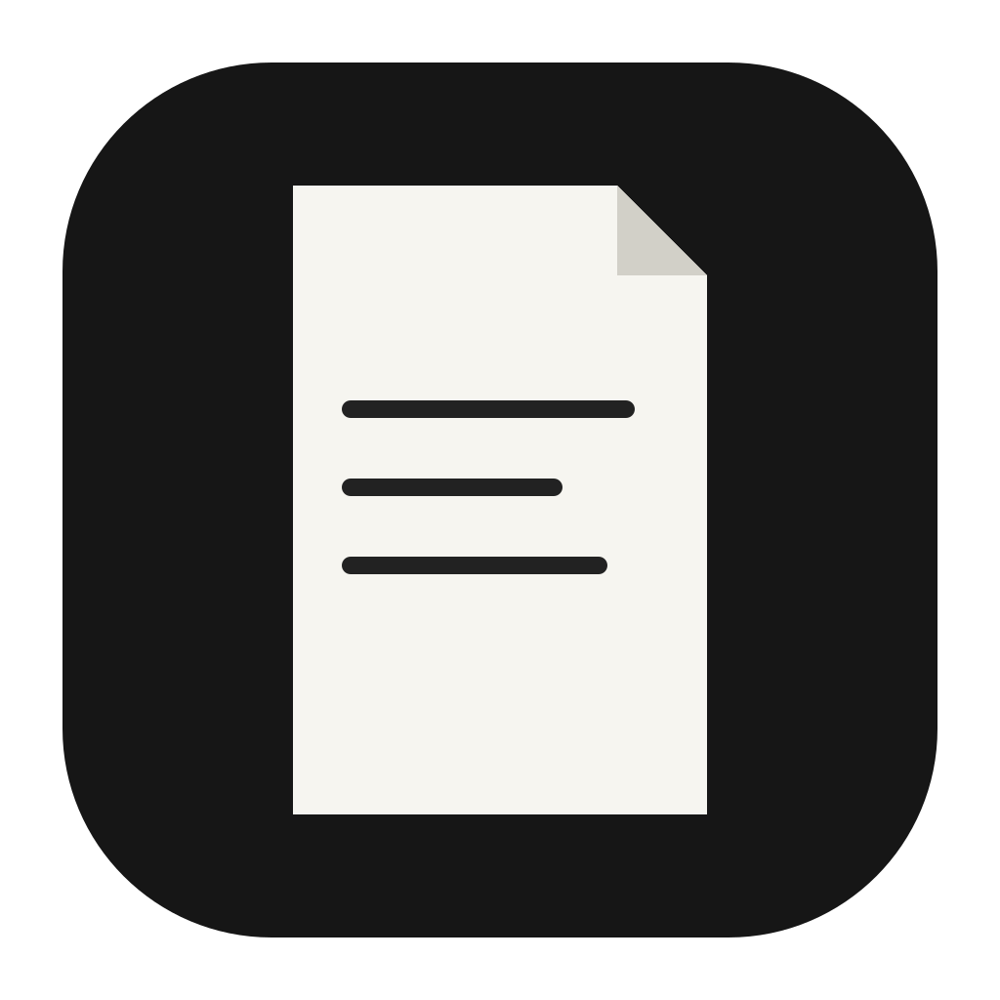

# Folio app icon



**Mark:** a single sheet of paper with a folded top-right corner and three short text lines.

**Idea:** the page is the product. The large empty lower half and the monochrome palette carry the
"quieter PDF reader" idea, and the silhouette stays readable at 16 px. There is no telegram/plane
symbol and no upstream brand mark.

**Palette:** three values.

| Colour | Hex | Used for |
|---|---|---|
| Tile | `#161616` | the rounded square |
| Paper | `#F6F5F0` | the sheet |
| Ink | `#222222` | the text lines and fold shadow |

**Tile:** a rounded square on Apple's icon grid with a transparent margin; the same page mark is
used by the window icon, the About dialog and the home header.

**Provenance:** drawn for this fork, not copied from the upstream icon. Licence:
[LICENSE.txt](LICENSE.txt) (`MIT OR Apache-2.0`, like the repository).

## Files

| File | What it is |
|---|---|
| `pdfcraft.svg` | master vector |
| `pdfcraft-small.svg` | the same mark, kept for places where a small vector is useful |
| `pdfcraft-1024.png` | 1024 px on Apple's grid; also the runtime Dock icon on macOS |
| `pdfcraft.icns` | macOS icon (16–1024 px) |
| `pdfcraft.ico` | Windows icon (16–256 px), embedded in `pdfcraft.exe` |
| `pdfcraft-document.svg` | Windows PDF file icon master (Lucide file outline) |
| `pdfcraft-document.ico` | Windows PDF file icon, embedded as resource 2 |
| `hicolor/<n>x<n>/apps/ai.storyteller.pdfcraft.png` | Linux hicolor theme, 16–512 px |
| `hicolor/scalable/apps/ai.storyteller.pdfcraft.svg` | Linux scalable icon (copy of the master) |

Where it shows: `apps/pdfcraft/src/main.rs` sets the window icon; `packaging/linux/ai.storyteller.pdfcraft.desktop`
names the hicolor icon.

## Regenerate

```sh
packaging/icons.sh        # needs resvg and python3; iconutil (macOS) for the .icns
cargo xtask assets --write
```
